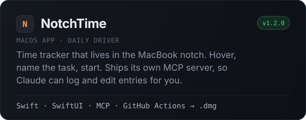
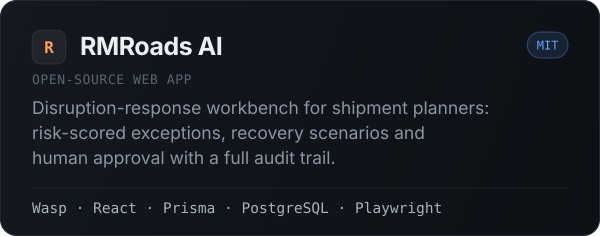
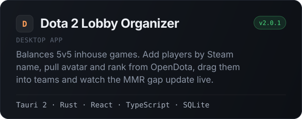
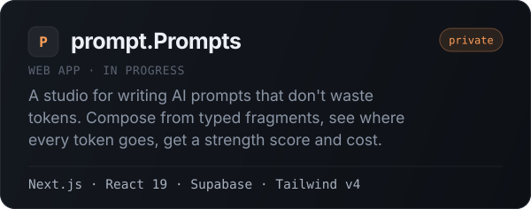

  

I build small, sharp tools I actually use, and I keep real businesses' IT running.
Web development student (2º DAW, IES Balmis) in Alicante, Spain, freelancing as an IT administrator on the side.

## Things I've built

  
  
  
  

## Beyond code

I work as a freelance IT admin for small businesses, so I'm the one who gets called when the logins, phones or remote desktops break:

- **Google Workspace**: deployments, user management and security policies
- **Google Voice**: auto attendants, ring groups, call recording, caller-ID policy
- **AWS WorkSpaces**: locked-down remote desktops for distributed teams, with Managed Microsoft AD, Group Policy and 1Password Business

Because of that work, my code tends to come with audit trails, sensible permissions and documentation, not just the happy path.

## Toolbox

**Build** &nbsp;TypeScript · React · Next.js · Node · Swift / SwiftUI · Rust (Tauri) · Prisma · PostgreSQL · Supabase · Tailwind 
**Run** &nbsp;Google Workspace · AWS · Active Directory / GPO · Docker · GitHub Actions 
**Exploring** &nbsp;MCP servers & agent tooling · Unity · PHP / Magento 2

<!--
## Contact

Open to junior full-stack roles and freelance IT work. EU-based, remote or hybrid.

-->
